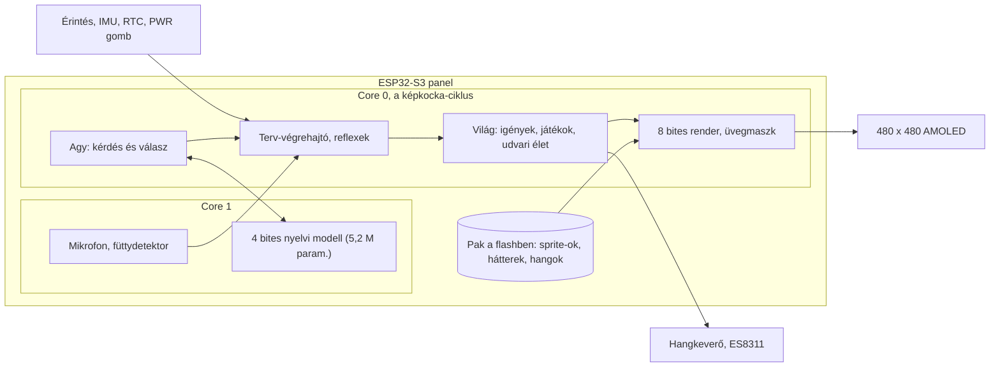

<div align="center">

# Pixel Lili

**Zsebben hordható virtuális chihuahua egy ESP32-S3 panelen, Lili emlékére**


[Funkciók](#funkciók) · [Képernyőképek](#képernyőképek) · [Architektúra](#architektúra) · [Telepítés](#telepítés)

</div>

> [!NOTE]
> **English summary.** Pixel Lili is a pocket-sized virtual chihuahua on a Waveshare ESP32-S3 AMOLED 2.16 panel, made in memory of Lili, a real dog who died on 12 September 2026. She lives on her own without internet: a 5.2 M-parameter 4-bit language model on the second core decides what she does, trained on a rule engine that encodes Lili's real habits. It is a fork of [mediacutlet/pocket-tank](https://github.com/mediacutlet/pocket-tank) (MIT): the hardware ports, the 4-bit LLM engine and the simulator frame come from there, the fish became a dog.

<p align="center">
  
</p>

## A probléma

Lili 2019 januárjában született, és 2026. szeptember 12-én ment el. A hangjáról nincs felvétel, a szokásai (a mély, félig vonyító ugatás, a sarokülő alá bújás bűntudatában, a szőnyegen alvás) csak emlékként élnek. Egy fotóalbum nem mozog, egy általános kutyás játék pedig nem ő.

## A megoldás

Egy kis kijelzős eszköz, amin Lili a saját szokásai szerint él tovább: eszik, alszik, rosszalkodik, játszik, kimegy az udvarra, és reagál az érintésre, a füttyre és arra, hogy elővesszük a zsebből. A viselkedését egy helyben futó, pici nyelvi modell választja ki, amelyet a gazdi leírásaiból írt szabálymotor mintáin tanítottunk. Nem kell hozzá internet, telefon vagy felhő.

## Funkciók

- **Saját élete.** Éhes lesz, szomjas, elfárad, unatkozik, magányos lesz és pisilnie kell; ha a pelenka tele van, a padlóra pisil, utána bűnösen a sarokülő alá bújik, amíg fel nem takarítasz.
- **56 animáció 8 irányban.** PixelLab-bal generált és kézzel tisztított pixel art: ugatás felcsapott fejjel, simogatás, kötélhúzás, plüss hordása, ásás, hempergés, felugrás a sarokülőre.
- **Szoba és élő udvar.** Négy évszak és négy napszak fénnyel és árnyékkal; az udvaron veréb csipeget és elrepül, ha Lili odarohan, nyáron pillangók, ősszel levelek hullnak, télen havazik.
- **Érintés, hang, mozgás.** Koppintás, simogatás, a játék eldobása pöccintéssel; füttyre előjön (mikrofonos füttydetektor), rázásra megriad, felvételre felébred. Saját hangjai vannak (ugatás, szaglászás, evés, ivás, horkolás).
- **Gondozás.** Etetés, itatás, jutalomfalat, pelenkacsere és takarítás koppintással; a tálak láthatóan fogynak.
- **Valós idő.** RTC óra, évszakok a dátumból, különleges napok; ha sokáig távol voltál, leéli a kiesett időt, és egy jelenettel fogad.
- **Emléklap és napló.** A bal szélről behúzva az emléklap, a jobb szélről a napló: hány napja vagytok együtt, mennyit evett, ivott, és hova pisilt.
- **Takarékos.** A kijelző elhalványul, elalszik, akkun 5 perc alvó kijelző után kikapcsol; a PWR gomb rövid nyomásra kijelzőt kapcsol, hosszúra ment és kikapcsol.

## Képernyőképek

<table>
  <tr>
    <td align="center" width="50%"><br/><sub>Nyári udvar pillangókkal és csipegető verébbel</sub></td>
    <td align="center" width="50%"><br/><sub>Felugrott a sarokülőre, és a takarón alszik</sub></td>
  </tr>
  <tr>
    <td align="center" width="50%"><br/><sub>Az emléklap: Lili odajön és leül elé</sub></td>
    <td align="center" width="50%"><br/><sub>Lili naplója (minta számokkal)</sub></td>
  </tr>
  <tr>
    <td align="center" width="50%"><br/><sub>Téli este az udvaron</sub></td>
    <td align="center" width="50%"><br/><sub>A szoba éjjel</sub></td>
  </tr>
</table>

## Architektúra



A közös C mag (`common/lili`) ugyanaz a panelen és a szimulátorban: a világ, a terv-végrehajtó, a navigáció, a gesztusok és a render. A modell a második magon fut, egy döntés kb. 1,7 másodperc; addig Lili tétlenkedik, modell nélkül a szabálymotor dönt. A grafika és a hangok egy saját flash-partíción lévő csomagból (pak) jönnek, memóriába leképezve.

## Technológiák

| Réteg | Technológia |
|---|---|
| Firmware | C, ESP-IDF 5, FreeRTOS, ESP32-S3 (Waveshare AMOLED 2.16) |
| Agy | 4 bites kvantált transzformer saját C motoron, PyTorch tanítás (WSL, CUDA) |
| Szimulátor | C, SDL2, LVGL, fej nélküli öntesztek |
| Grafika | PixelLab (PixMiniMax), Python + Pillow + NumPy feldolgozás |
| Hang | ElevenLabs hangeffektek, G.711 µ-law bank, ES8311 kodek |
| Eszközök | Python 3.12 (pak építés, flashelés, sprite-ok, hangbank) |

## Telepítés

Előfeltételek: WSL (Ubuntu 24.04) SDL2-vel, ESP-IDF 5, Python 3.12, a panel USB-n.

1. Szimulátor fordítása és indítása:
   ```bash
   cd sim && make LILI=1 && ./lilisim
   ```
2. A firmware fordítása:
   ```bash
   bash tools/build_lili.sh
   ```
3. Flashelés (app, grafikai csomag és modell):
   ```bash
   py -3.12 tools/flash_216.py lili
   ```

## Használat

- **Szimulátor:** Tab szoba/udvar, W fütty, Space rázás, Enter felvétel, T +1 óra, 1-4 évszak, D napszak, G bemutató, Q kilépés mentéssel. Az egér a képen az ujj.
- **Panel:** simogasd oda-vissza húzva, pöccintsd el a játékot, koppints a tálra vagy a foltra. Felső vagy alsó szélről húzva vált szobát, a bal szélről az emléklap, a jobb szélről a napló jön. BOOT: állapotsáv, PWR: kijelző ki/be, hosszan: kikapcsolás.
- **Tesztek:** `cd sim && make LILI=1 check` (26 önteszt csoport, ablak nélkül).
- **Az agy tanítása:** lásd [docs/retrain-v4.md](docs/retrain-v4.md) és a `model/` mappa.

## Mappaszerkezet

```text
pixel-lili/
├── common/lili/     # a közös C mag: világ, terv, navigáció, render, hang, udvari élet
├── firmware/lili/   # az ESP32-S3 app (ESP-IDF): test, hang, érintés, energia
├── sim/             # SDL2 szimulátor és öntesztek
├── model/           # a tanár szabályai, tanítás, 4 bites export
├── assets/          # sprite-ok, hátterek, térképek, hangok, paletták
├── tools/           # pak építés, flashelés, PixelLab és ElevenLabs feldolgozás
├── docs/            # döntések, státusz, mérések, képernyőképek
└── PIXEL_LILI_SPEC.md  # a teljes terv
```

## Tervek

- [ ] 7 napos valós próba a panelen, akkus mérésekkel
- [ ] A modell újratanítása az új udvari és sarokülős viselkedéssel
- [ ] Évszakos díszek és a különleges napok saját jelenetei
- [ ] Lili hangjainak finomhangolása a kis hangszóróra

## Licenc

MIT, lásd [LICENSE](LICENSE). A [mediacutlet/pocket-tank](https://github.com/mediacutlet/pocket-tank) eredeti szerzői jogi megjegyzése megmaradt; az átvett részek térképe: [docs/UPSTREAM.md](docs/UPSTREAM.md).

---

<div align="center">
<sub>Készítette: Pintér Szabolcs · <a href="https://github.com/piszabolcs">GitHub</a> · <a href="https://www.linkedin.com/in/piszabolcs">LinkedIn</a></sub>
</div>
