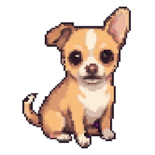
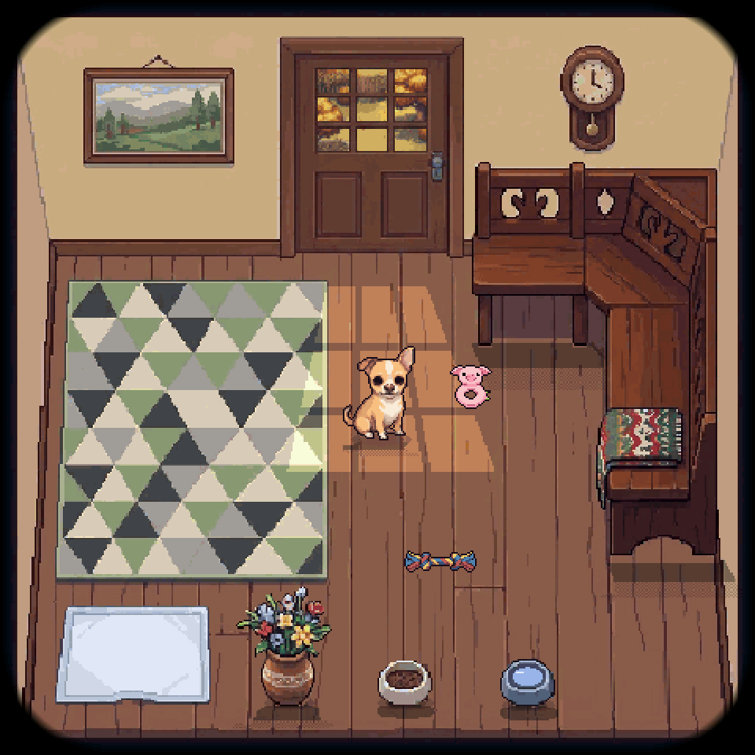
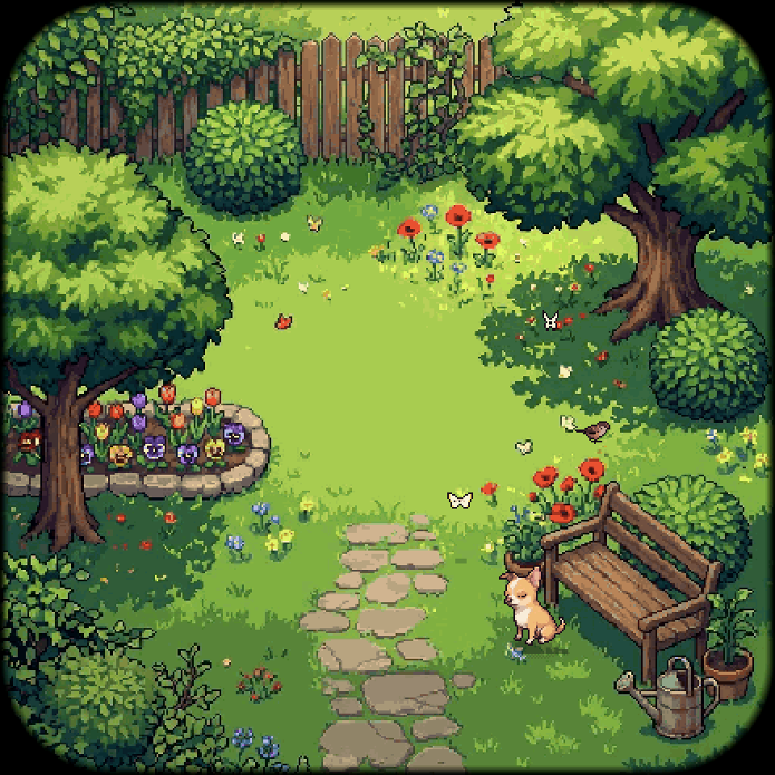
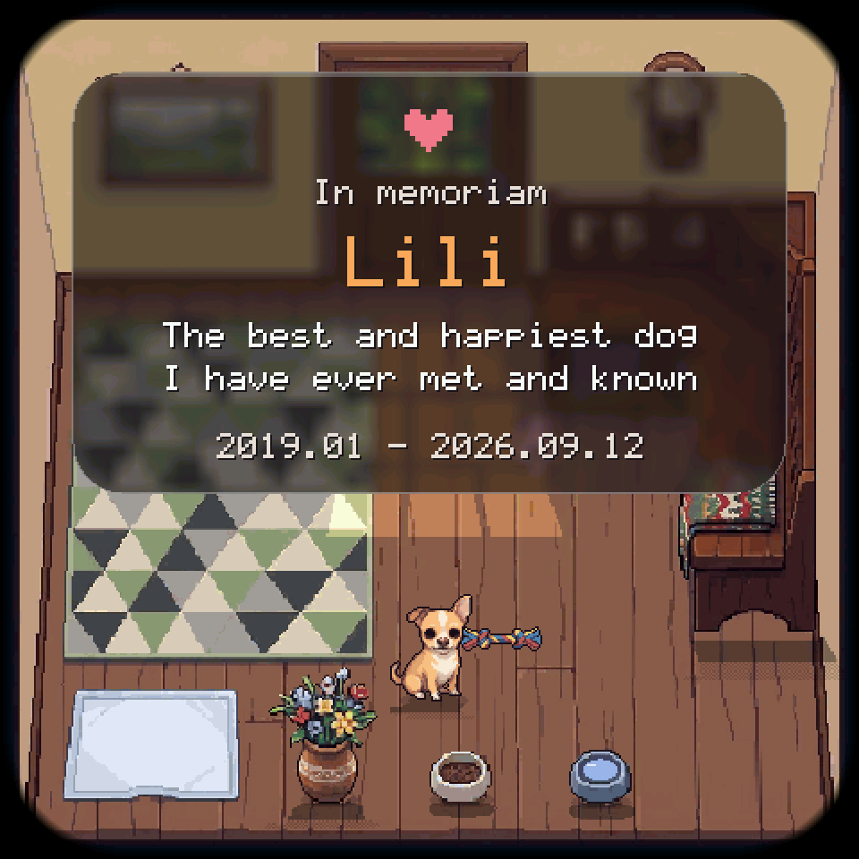
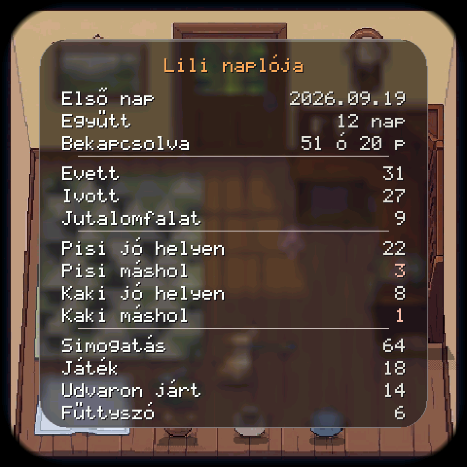
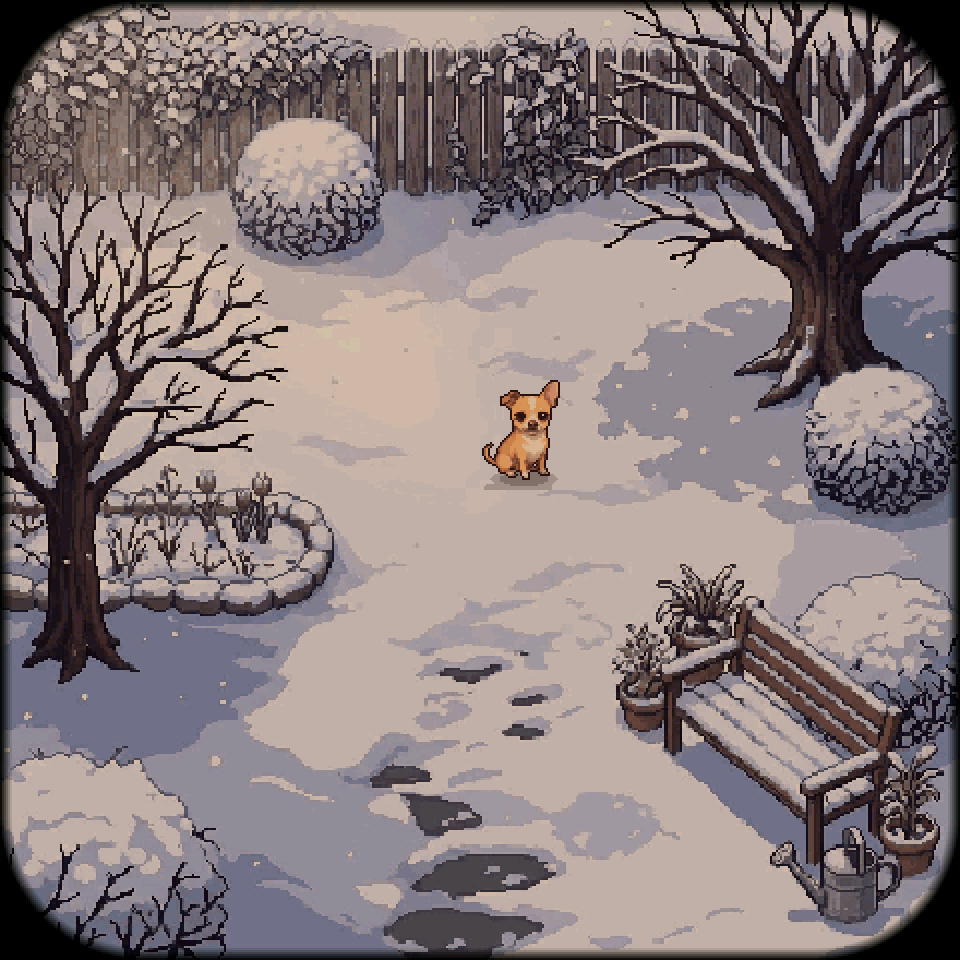
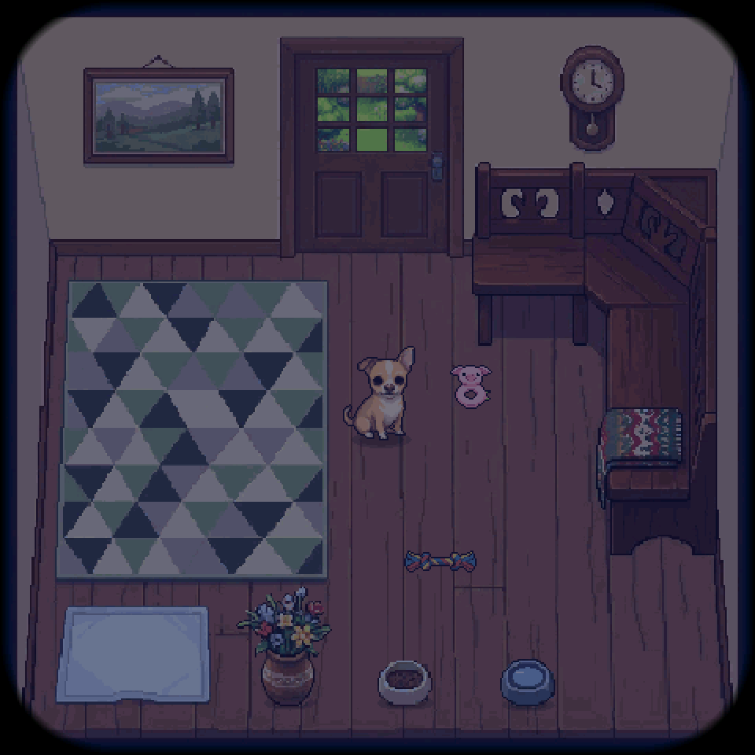
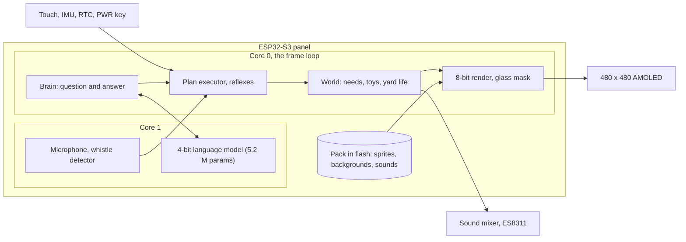

<div align="center">



# Pixel Lili

**A pocket-sized virtual chihuahua on an ESP32-S3 panel, in memory of Lili**


[Features](#features) · [Screenshots](#screenshots) · [Architecture](#architecture) · [Installation](#installation)

</div>

<p align="center">
  
</p>

## The problem

Lili was born in January 2019 and died on 12 September 2026. There is no recording of her voice, and her habits (a deep, half-howling bark, hiding under the corner bench when she felt guilty, sleeping on the rug) live on only as memories. A photo album does not move, and a generic dog game is not her.

## The solution

A small device on which Lili lives on by her own habits: she eats, sleeps, gets up to mischief, plays, goes out to the yard, and reacts to touch, to a whistle and to being taken out of a pocket. What she does next is chosen by a tiny language model running on the device, trained on samples from a rule engine written from the owner's descriptions of her. No internet, phone or cloud needed.

This is a fork of [mediacutlet/pocket-tank](https://github.com/mediacutlet/pocket-tank) (MIT) by StratoBuilds: the board ports, the 4-bit LLM engine, the simulator frame and the save pattern come from there, and the fish became a dog. The map of what was taken over: [docs/UPSTREAM.md](docs/UPSTREAM.md).

## Features

- **A life of her own.** She gets hungry, thirsty, tired, bored and lonely, and needs to pee; with a full pad she pees on the floor, then hides under the corner bench, guilty, until you clean up.
- **56 animations in 8 directions.** Pixel art generated with PixelLab and cleaned by hand: barking with her head thrown up, being petted, tug of war, carrying her plush, digging, rolling on her back, leaping onto the corner bench.
- **A room and a living yard.** Four seasons and four times of day with light and shadow; in the yard a sparrow pecks and flies off when she dashes at it, butterflies in summer, falling leaves in autumn, snow in winter.
- **Touch, sound, motion.** Tap, pet, flick her toy; she comes to a whistle (a microphone whistle detector), startles when shaken, wakes when picked up. She has her own sounds: barking, sniffing, eating, drinking, snoring.
- **Care.** Feeding, water, treats, changing the pad and cleaning up by tapping; the bowls visibly empty.
- **Real time.** An RTC clock, seasons from the date, special days; after a long absence she lives through the missed time and greets you with a scene.
- **Memorial and diary.** Swipe in from the left edge for the memorial page, from the right edge for her diary: days together, meals, drinks, and where she did her business.
- **Battery-friendly.** The screen dims and sleeps, and on battery the device powers off after 5 minutes of a sleeping screen; a short PWR press toggles the screen, a long one saves and powers off.

## Screenshots

<table>
  <tr>
    <td align="center" width="50%"><br/><sub>The summer yard with butterflies and a pecking sparrow</sub></td>
    <td align="center" width="50%"><br/><sub>She leapt up onto the corner bench and sleeps on the blanket</sub></td>
  </tr>
  <tr>
    <td align="center" width="50%"><br/><sub>The memorial page: Lili comes and sits before it</sub></td>
    <td align="center" width="50%"><br/><sub>Lili's diary (sample numbers, the interface is in Hungarian)</sub></td>
  </tr>
  <tr>
    <td align="center" width="50%"><br/><sub>A winter evening in the yard</sub></td>
    <td align="center" width="50%"><br/><sub>The room at night</sub></td>
  </tr>
</table>

## Architecture



The shared C core (`common/lili`) is the same on the panel and in the simulator: the world, the plan executor, navigation, gestures and rendering. The model runs on the second core and a decision takes about 1.7 seconds; meanwhile Lili idles, and without a model the rule engine decides. Graphics and sounds come from a pack in its own flash partition, memory-mapped.

## Tech stack

| Layer | Technology |
|---|---|
| Firmware | C, ESP-IDF 5, FreeRTOS, ESP32-S3 (Waveshare AMOLED 2.16) |
| Brain | 4-bit quantized transformer on its own C engine, PyTorch training (WSL, CUDA) |
| Simulator | C, SDL2, LVGL, headless self-tests |
| Graphics | PixelLab (PixMiniMax), processed with Python, Pillow and NumPy |
| Sound | ElevenLabs sound effects, a G.711 µ-law bank, ES8311 codec |
| Tools | Python 3.12 (pack building, flashing, sprites, sound bank) |

## Installation

Prerequisites: WSL (Ubuntu 24.04) with SDL2, ESP-IDF 5, Python 3.12, the panel on USB.

1. Build and start the simulator:
   ```bash
   cd sim && make LILI=1 && ./lilisim
   ```
2. Build the firmware:
   ```bash
   bash tools/build_lili.sh
   ```
3. Flash the app, the graphics pack and the model:
   ```bash
   py -3.12 tools/flash_216.py lili
   ```

## Usage

- **Simulator:** Tab room/yard, W whistle, Space shake, Enter pick up, T +1 hour, 1-4 season, D time of day, G demo, Q quit with save. The mouse on the picture is the finger.
- **Panel:** pet her by stroking back and forth, flick her toy, tap a bowl or a spot. A swipe from the top or bottom edge switches the room, from the left edge the memorial, from the right the diary. BOOT: status bar, PWR: screen on/off, long press: power off.
- **Tests:** `cd sim && make LILI=1 check` (26 self-test groups, no window).
- **Training the brain:** see [docs/retrain-v4.md](docs/retrain-v4.md) and the `model/` folder.

## Project structure

```text
pixel-lili/
├── common/lili/     # the shared C core: world, plans, navigation, render, sound, yard life
├── firmware/lili/   # the ESP32-S3 app (ESP-IDF): body, sound, touch, power
├── sim/             # the SDL2 simulator and self-tests
├── model/           # the teacher's rules, training, 4-bit export
├── assets/          # sprites, backgrounds, maps, sounds, palettes
├── tools/           # pack building, flashing, PixelLab and ElevenLabs processing
├── docs/            # decisions, status, measurements, screenshots
└── PIXEL_LILI_SPEC.md  # the full plan (in Hungarian)
```

## Roadmap

- [ ] A 7-day real-life trial on the panel with battery measurements
- [ ] Retraining the model with the new yard and corner bench behaviour
- [ ] Seasonal decorations and scenes for the special days
- [ ] Fine-tuning Lili's sounds for the small speaker

## Thanks

To [StratoBuilds](https://github.com/mediacutlet) for [pocket-tank](https://github.com/mediacutlet/pocket-tank): the idea, the hardware groundwork and the on-device LLM engine that made Lili possible.

## License

MIT, see [LICENSE](LICENSE). The original copyright notice of [mediacutlet/pocket-tank](https://github.com/mediacutlet/pocket-tank) is kept.

## Magyarul röviden

A Pixel Lili egy zsebben hordható virtuális chihuahua, Lili emlékére, aki 2026. szeptember 12-én ment el. A saját szokásai szerint él egy ESP32-S3 panelen, internet nélkül, egy helyben futó kis nyelvi modell irányításával. A felület, a fejlesztési napló és a döntések ([docs/decisions.md](docs/decisions.md)) magyarul vannak.

---

<div align="center">
<sub>Built by Szabolcs Pintér · <a href="https://github.com/piszabolcs">GitHub</a> · <a href="https://www.linkedin.com/in/piszabolcs">LinkedIn</a></sub>
</div>
