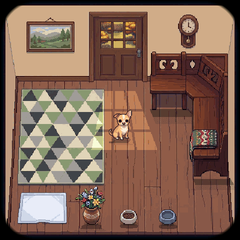
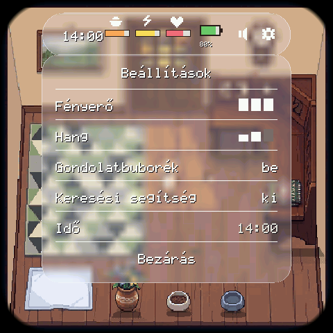
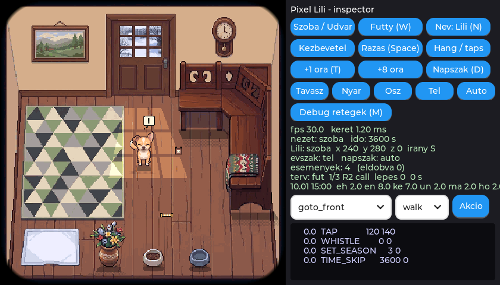

# Pixel Lili

Zsebben hordható, érintőképernyős virtuális kutya **Lili**, a 2026. szeptember 12-én elhunyt chihuahua emlékére. Egy Waveshare ESP32-S3-Touch-AMOLED-2.16 panelen fut, internet nélkül. A viselkedését egy helyben futó, pici nyelvi modell irányítja, amelyet Lili valódi szokásaiból tanítottunk (egy szabálymotor "tanár" mintáiból).

A projekt a [mediacutlet/pocket-tank](https://github.com/mediacutlet/pocket-tank) (MIT) kódbázisára épül: a hardveres portokat, a 4 bites LLM-motort, a szimulátor keretet és a mentési mintát onnan vesszük át, a halakat Lili váltja fel. Az átvett részek térképe: [docs/UPSTREAM.md](docs/UPSTREAM.md).

| A szoba (ősz, délután) | Az udvar (tél, este) | Az állapotsáv és a beállítások |
|---|---|---|
|  |  |  |



## Mit tud

1. **Lili 33 animációval él** mind a 8 irányban (PixelLab, a gazdi jóváhagyásával), a szobában és az udvaron, négy évszakkal és négy napszakkal, fénnyel és árnyékkal.
2. **Magától él:** éhes lesz, elfárad, unatkozik, magányos lesz, pisilnie kell; eszik, alszik a kuckóban, napozik, bújócskázik a bokorban, játszik a kötéllel és a plüssel, és ha a pelenka tele van vagy nagyon unatkozik, a padlóra pisil, utána bűnösen a sarokülő alá bújik, amíg fel nem takarítasz.
3. **Az agya** egy 5,2 millió paraméteres modell (4 bit, 2,76 MB), a panel második magján fut, egy döntés 1,7 mp. Ha nincs modell, ugyanazt a szabálymotor teszi (`model/teacher_rules.yaml`, a 15 szokás).
4. **Az érintés:** koppintás, simogatás (oda-vissza húzás rajta), a játék eldobása pöccintéssel, húzása, felhúzás a szélről (nézetváltás), koppintás az ajtón. Etetés, pelenkacsere, takarítás koppintással.
5. **A test:** füttyre előjön (a mikrofon füttydetektora), rázásra megriad és ugat, felvételre felébred; a kijelző elhalványul, ha nem nézed, zsebben kikapcsol.
6. **Az idő:** valós óra (RTC), évszakok a dátumból, különleges napok (január 15., június 27., szeptember 12.: ezen a napon nem rosszalkodik, a közeledben marad). Ha sokáig távol vagy, a távollétet is leéli (mit evett, aludt, csinált), és egy jelenettel fogad.
7. **Mentés** 5 percenként (NVS), áramszünet után is ott folytatja, ahol abbahagyta.

## Kipróbálás a szimulátorban (WSL, Ubuntu)

```bash
cd sim && make LILI=1 && ./lilisim
```

Billentyűk: Tab szoba/udvar, W fütty, N név, Space rázás, Enter felvétel, T +1 óra, 1-4 évszak, D napszak, A animáció, R irány, B állapotsáv, G bemutató, M debug, Q kilépés (mentéssel). Az egér a képen az ujj. Az inspectorban akcióválasztó is van.

További módok: `./lilisim --brain llm` (a betanított modellel), `--demo` (bemutató kör), `--anim-viewer` (egy animáció mind a 8 irányból), `--snapshot DIR` (4 évszak x 4 napszak x 2 nézet), `--fresh` (új kezdés).

## A panelen

```bash
bash tools/build_lili.sh
```

```bash
py -3.12 tools/flash_216.py lili
```

A `lili` készlet az appot, a pakot (a grafika, 3,97 MB) és a modellt is felírja. Soros konzol: `py -3.12 tools/serial_log.py --seconds 60 --send "help"`. Parancsok: `time`, `settime 2026-10-27T14:05:00`, `status`, `brain rules|model`, `demo`, `whistle`, `shake`, `wake`.

Gombok: BOOT = állapotsáv, KEY3 = szoba/udvar, PWR = kijelző ki/be.

## Az agy tanítása (RTX 5060, WSL)

```bash
cd sim && for s in $(seq 1 32); do ./lilisim --dump-traces ../model/out/lili/traces_s$s.jsonl --hours 100 --seed $s & done; wait
```

```bash
python3 model/prep_lili.py && python3 model/train_lili.py --size S && python3 model/eval_lili.py --size S && python3 model/export_lili_q4.py --size S
```

184 ezer tanítópár, 3 perc tanítás. Az S modell: A1 87 % egyezés a tanár legvalószínűbb választásával, a tanár címkéje a top-2-ben 93,6 %, mind a 12 viselkedési próba (P1-P12) teljesül, a panelen is.

## Tesztek

`cd sim && make LILI=1 check`: 18 önteszt (render, navigáció, gesztusok, terv-végrehajtó, reflexek, játékfizika, igények, naptár, távollét, mentés, próbák, egy nap élet, a modell a C motoron, mozgásérzékelő, felület) és a sebességmérés. Csak zöld állapot kerül commitba.

## Hol tart

Állapot és a nyitott kérdések: [docs/STATUS.md](docs/STATUS.md) (a tetején áttekintő tábla). Döntések: [docs/decisions.md](docs/decisions.md). Mérések: [docs/stats.md](docs/stats.md). A teljes terv: [PIXEL_LILI_SPEC.md](PIXEL_LILI_SPEC.md) (12. fejezet: mérföldkövek). Munkaszabályok: [CLAUDE.md](CLAUDE.md).

Ami még hátravan: a hiányzó grafikák (évszakos díszek, különleges napok, játékok, foltok, ikonok, néhány animáció), Lili saját hangja a gazdi videóiból (M9), a 7 napos valós próba a panelen (M11.1), utána a v1.0.
