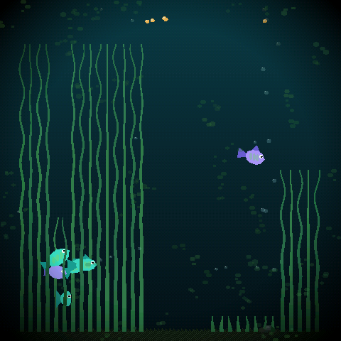

# Pixel Lili

Zsebben hordható, érintőképernyős virtuális kutya **Lili**, a 2026. szeptember 12-én elhunyt chihuahua emlékére. Egy Waveshare ESP32-S3-Touch-AMOLED-2.16 panelen fut, internet nélkül; a viselkedését egy helyben futó, pici nyelvi modell irányítja, amelyet Lili valódi szokásaiból tanítunk.

A projekt a [mediacutlet/pocket-tank](https://github.com/mediacutlet/pocket-tank) (MIT) kódbázisára épül: a hardveres portokat, a 4 bites LLM-motort, a szimulátor keretet és a mentési mintát onnan vesszük át, a halakat Lili váltja fel. Az átvett részek térképe: [docs/UPSTREAM.md](docs/UPSTREAM.md).

## Hol tart

Állapot: [docs/STATUS.md](docs/STATUS.md). Mérföldkövek és a teljes terv: [PIXEL_LILI_SPEC.md](PIXEL_LILI_SPEC.md) (12. fejezet). Munkaszabályok: [CLAUDE.md](CLAUDE.md).

| Mérföldkő | Állapot |
|---|---|
| M0 Környezet és repó | kész (2026-10-18) |
| M1 Hardver-validáció | a panelre vár |
| M2 Váz: Lili modul a hal helyett | |
| M3 Grafikai gyártósor (Blender, 8 irány) | |
| M4-M6 Világ, igények, szabálymotor agy | |
| M7-M8 LLM tanítása és az eszközön | |
| M9-M11 Hang, felület, v1.0 | |

## Képernyőképek

M0: a pocket-tank négyzetes szimulátora fordul és tesztel a WSL2-es fejlesztői környezetben (ez még az akvárium, Lili az M2-M3-ban költözik be):

További képek mérföldkövenként a `docs/img/` mappába kerülnek (M2: helyőrző szoba és udvar, M3: Lili első kontaktlapja, M6: Lili a panelen).

## Fejlesztői környezet (röviden)

- Windows 11 + WSL2 Ubuntu 24.04 (tükrözött hálózat), a repó a WSL fájlrendszerében: `~/dev/pixel-lili`
- Szimulátor: `cd sim && make SQUARE=1 && ./fishsim-square`, tesztek: `make SQUARE=1 check`
- Firmware: ESP-IDF v5.4.1 (`. ~/esp/esp-idf/export.sh`), részletek: [docs/UPSTREAM.md](docs/UPSTREAM.md) 3. fejezet
- Modell: `.venv` (Python 3.11, PyTorch CUDA 12.8), RTX 5060
- Grafika: Blender 4.x + mcp-for-blender (M3-tól)

A teljes telepítési lista: [docs/2026-10-18_felmeres_brainstorming_telepites.md](docs/2026-10-18_felmeres_brainstorming_telepites.md).

## Licenc

MIT. A pocket-tank szerzői joga: Copyright (c) 2026 MediaCutlet (lásd [LICENSE](LICENSE)); a Lili-specifikus részek: Pintér Szabolcs. A `reference/` mappa fotói magáncélúak, nem újrafelhasználhatók.